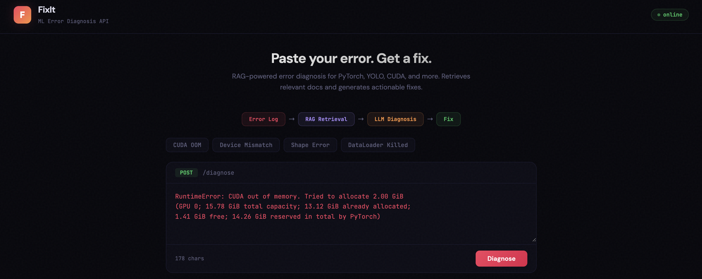
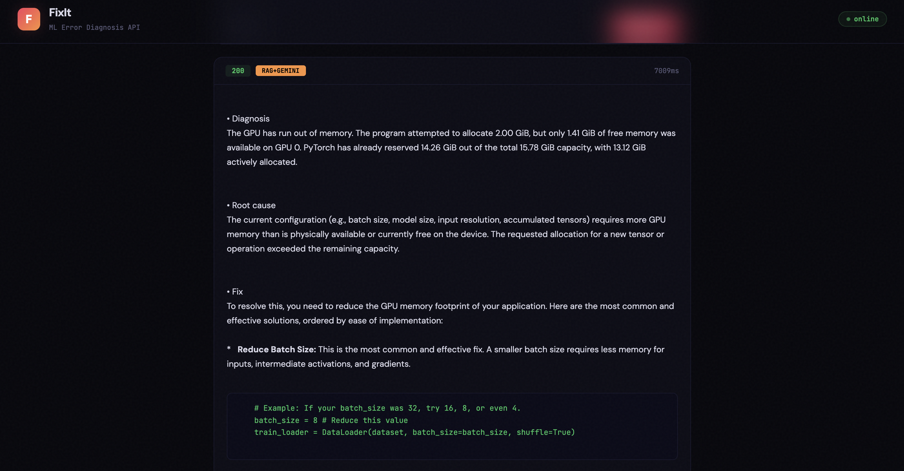

# FixIt

**LLM Diagnostic Engine for ML Training Failures**

RAG-powered error diagnosis for PyTorch, YOLO, CUDA, and more. Paste a stack trace — get a root cause and an actionable fix.



---

## What it does

FixIt is an end-to-end diagnostic API for ML training errors. It retrieves relevant documentation chunks via FAISS, passes them to an LLM alongside the user's error log, and returns a structured diagnosis: root cause, fix, and code snippets.



---

## Architecture

```
Error Log  →  RAG Retrieval  →  LLM Diagnosis  →  Fix
              (FAISS + MiniLM)   (Gemini / Mistral)
```

- **Retrieval** — 347 PyTorch / YOLO / CUDA doc chunks embedded with `sentence-transformers`, indexed in FAISS for sub-100ms top-k lookup.
- **Generation** — Gemini API for production serving, or a locally fine-tuned Mistral-7B (QLoRA) for offline use.
- **Serving** — FastAPI with a `/diagnose` endpoint and a minimal web UI.

---

## Training

QLoRA fine-tune of Mistral-7B on **684 error→fix pairs** scraped from Stack Overflow and GitHub issues.

| Metric | Value |
|---|---|
| Raw pairs scraped | 921 |
| Clean pairs (post-filter) | 684 |
| Train / Val split | 615 / 69 |
| Avg error length | ~1,076 chars |
| Avg fix length | ~716 chars |
| Training loss | 1.43 → 0.85 |

The data pipeline filters short errors, short fixes, and pairs lacking a clear error signal before training.

---

## Stack

Python · Mistral-7B · QLoRA · HuggingFace PEFT · FAISS · sentence-transformers · FastAPI · LangChain · Gemini API

---

## Repo layout

```
src/
  api/        FastAPI app + static UI
  data/       Scrapers (Stack Overflow, GitHub) + cleaning pipeline
  rag/        FAISS index builder + retriever
  config.py
data/
  raw/        Scraped error→fix pairs (.jsonl)
  processed/  Cleaned splits, chunks, FAISS index
```

---

## Run it

```bash
# install
pip install -r requirements.txt

# build the RAG index (one-time)
python -m src.rag.build_index

# serve
uvicorn src.api.main:app --reload
```

Open `http://localhost:8000` and paste a stack trace.

---

## Example

**Input**
```
RuntimeError: CUDA out of memory. Tried to allocate 2.00 GiB
(GPU 0; 15.78 GiB total capacity; 13.12 GiB already allocated;
1.41 GiB free; 14.26 GiB reserved in total by PyTorch)
```

**Output** — diagnosis, root cause, and a ranked list of fixes (reduce batch size, gradient checkpointing, mixed precision, `torch.cuda.empty_cache()`, etc.) with runnable code snippets.
